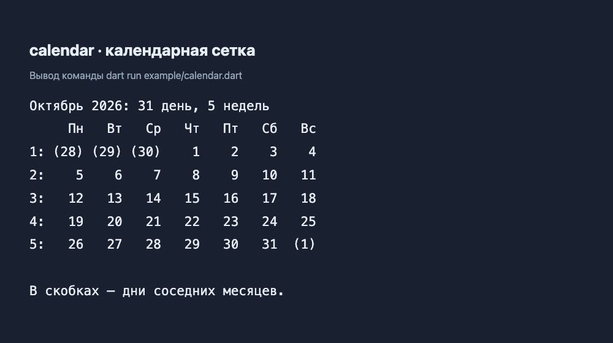

# calendar

Библиотека на Dart для календарных расчётов: годы, месяцы, недели и дни.
Используется в LKO Planner и служит основой для Flutter-виджетов
[calendar_ui](https://github.com/Hecatoncheir/calendar_ui).
Не зависит от Flutter: подходит для приложений, серверов и консольных программ.

## Пример результата



Скриншот показывает оформленный вывод запускаемого примера
[`example/calendar.dart`](example/calendar.dart). В скобках — дни соседних
месяцев, которые дополняют крайние недели. Собственного графического интерфейса
у библиотеки нет.

## Возможности

| API | Назначение |
| --- | --- |
| `Year` | Месяцы года и выбор месяца по номеру |
| `Month` | Количество дней, список дней и недели с настраиваемым началом |
| `Day` | Дата, день недели и сравнение через `isSameDayAs` |
| `Week` | Номер недели в месяце и неизменяемая карта дней по дням недели |
| `fullWeeksOfMonth` | Полная сетка месяца с днями соседних месяцев |
| `DateTimeExtension` | Проверка високосного года и количество дней в месяце |

Месяцы нумеруются от 1 до 12, дни недели — от 1 (понедельник) до 7
(воскресенье), как в `DateTime`. Номер недели относится к сетке месяца,
а не к нумерации недель года по ISO 8601.
`Month.weeks` содержит только дни самого месяца; `fullWeeksOfMonth`
всегда даёт по семь дней на неделю и начинает её с понедельника.

## Требования и подключение

Dart `>=3.12.0 <4.0.0` и Git. Пакет имеет `publish_to: none`;
подключайте его напрямую из репозитория:

```yaml
dependencies:
  calendar:
    git:
      url: https://github.com/Hecatoncheir/calendar.git
      ref: ab1c4aba057e2006925f4cfd06191f625f4d0af7
```

`ref` фиксирует версию API; для другой версии укажите нужный commit или tag.
Затем выполните `dart pub get` (в Flutter-проекте — `flutter pub get`).
Для локальной копии вместо `git` используйте `path: ../calendar`.

## Использование

```dart
import 'package:calendar/calendar.dart';

void main() {
  final month = Month(year: 2026, month: DateTime.october);
  print(month.daysCount); // 31
  print(month.day(13)?.weekday); // 2: вторник

  final weeks = fullWeeksOfMonth(year: 2026, month: DateTime.october);
  final monday = weeks.first.days[DateTime.monday]!;
  print(monday.date); // 2026-09-28 00:00:00.000

  final year = Year(year: 2026);
  print(year.month(DateTime.february)?.daysCount); // 28
}
```

Для начала недели с воскресенья используйте
`Month(year: 2026, month: 10, whichDayToWeekStart: DateTime.sunday)`.
Расширение `DateTimeExtension` подключается отдельно:

```dart
import 'package:calendar/date_time_extension.dart';

final leapYear = DateTime(2028).isLeapYear(); // true
final days = DateTime(2028, 2).daysInMonthCount(); // 29
```

## Запуск примера и проверка

```bash
git clone https://github.com/Hecatoncheir/calendar.git
cd calendar
dart pub get
dart run example/calendar.dart
dart test
dart analyze
```

Тесты проверяют високосные годы, дни и недели месяца, выбранное начало недели
и заполнение крайних недель. Проверка зависимостей: `dart pub outdated`;
обновление в пределах ограничений: `dart pub upgrade`.

## Лицензия

[MIT](LICENSE).
